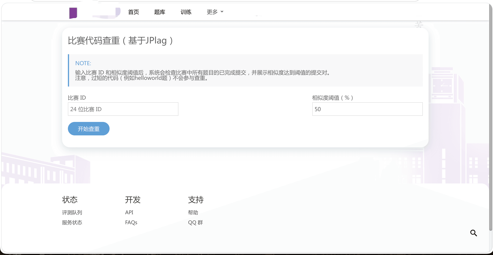
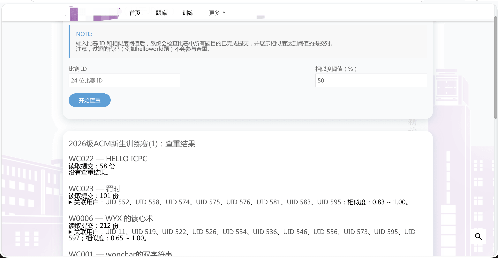
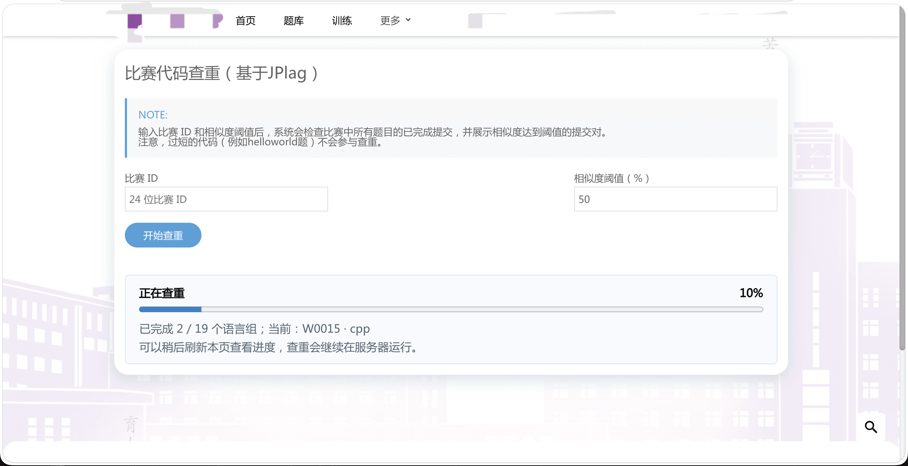

# hydrooj-sim

基于JPlag实现的 Hydro 比赛代码查重插件。管理员在输入比赛 ID 和相似度阈值后，插件按题目和语言分别调用 [JPlag](https://github.com/jplag/JPlag)，并在页面展示相似的提交对和并排代码 Diff。

也可以作为独立网站部署：用户上传 Hydro 导出的比赛代码 ZIP，输入阈值即可开始查重。独立模式不需要安装 Hydro OJ 或 MongoDB。

插件自带 [JPlag 6.2.0 JAR](https://github.com/jplag/JPlag/releases/download/v6.2.0/jplag-6.2.0-jar-with-dependencies.jar) 和 Linux x64（x86_64）Java 21 运行时。在 Linux x64 系统上，插件自动使用内置 Java，服务器无需另行安装 Java 或 JPlag。

其他操作系统或 CPU 架构则使用服务器 PATH 中的 `java`。请安装 Java 21 或更高版本，并确保 Hydro 服务进程能够执行 `java`。

由于内置 Java 和 JPlag，当前插件大小已超过 100 MB。

## 环境要求

- Node.js 22 或更高版本。
- Linux x64 自动使用包内 Java；其他平台需要在 PATH 中提供 Java 21 或更高版本。比较 Java 代码建议使用完整 JDK。

## 作为 Hydro 插件安装

1、安装命令：

**方式A：GitHub Release 压缩包安装 (推荐)**

在 [Releases](https://github.com/HuParry/hydrooj-sim/releases) 页面找到所需版本，在 Assets 中复制 `hydrooj-sim-版本号.tgz` 的下载链接，然后执行：

```sh
hydrooj install https://github.com/HuParry/hydrooj-sim/releases/download/v0.2.12/hydrooj-sim-0.2.12.tgz
pm2 restart hydrooj
```

请将示例版本号替换为实际发布版本。使用 Release 附件中的 `.tgz` 安装包；安装命令需要下载链接。

**方式B：git clone + 一键脚本**
```sh
git clone https://github.com/HuParry/hydrooj-sim.git ~/.hydro/addons/hydrooj-sim
cd ~/.hydro/addons/hydrooj-sim
./deploy.sh           # 自动 hydrooj addon add + pm2 restart hydrooj
```

2、重启 HydroOJ

3、在首页菜单加入超链接至 `/sim`，访问 `<OJ地址>/sim`。注意只有比赛拥有者、具有编辑比赛权限的管理员和系统管理员可以使用查重功能。

## 在 Hydro 中使用

1. 从比赛链接中复制 24 位比赛 ID，填入页面。
2. 输入相似度阈值（0–100，默认 50）。
3. 点击“开始查重”，页面会显示按题目和语言分组的查重进度。查重在服务器继续运行，可以稍后刷新任务页面查看结果。
4. 展开有结果的题目查看提交对；点击 Diff 可在弹窗中查看两份代码。UID 和提交 ID 均可点击进入相应页面。

插件读取该比赛各题所有已完成且含代码的提交，按题目和语言分组；不同语言不会互相比较，同一用户的提交对不会出现在结果中。JPlag 支持的语言使用对应解析器，其他语言使用 `text` 解析器，但仍按 Hydro 语言 ID 分组。

当前 JPlag JAR 支持 C、C++、C#、EMF、EMF Model、Go、Java、JavaScript、Kotlin、LLVM IR、Multi-language、Python 3、R、Rust、Scala、Scheme、SCXML、Swift、Text 和 TypeScript。Hydro 的常见语言变体（如 `cc.*`、`py.py3`、`py.pypy3`、`kt.jvm`）会映射到相应解析器。

页面展示 JPlag 的 `AVG` 相似度，百分比最多保留两位小数。插件使用原始精度筛选阈值，再格式化展示。JPlag 对最短匹配长度采用各语言默认值，因此过短或无法解析的代码可能不参与比较；页面不会显示跳过原因或数量。没有可展示的提交对时，页面显示“没有查重结果”。

每个语言组的运行超时默认为 300 秒，可通过 Hydro 系统设置 `jplag.timeoutSeconds` 调整，允许范围为 10–1800 秒。代码和 JPlag 报告只写入查重任务的临时目录，任务结束后会删除。任务进度和结果在数据库中保留约 24 小时。

## 独立网站部署

### 安装并启动

```sh
npm install --global hydrooj-sim
hydrooj-sim
```

启动后默认监听所有 IPv4 网络接口，本机可访问 `http://127.0.0.1:3000`，其他机器可访问 `http://服务器IP:3000`。独立模式不需要执行 `hydrooj addon add`。

也可以解压 Release 中的安装包，进入包含 `package.json` 的目录后运行 `npm start`，无需额外安装依赖。

### 服务器部署

默认即可从其他机器访问，无需设置 `HOST`，打开网站即可使用，无需登录或密码验证。请确保服务器防火墙或安全组允许访问相应端口：

```sh
hydrooj-sim
```

部署反向代理时请保留原始 `Host` 请求头，并将上传大小限制设为至少 `128m`、上传超时设为至少 120 秒。

| 环境变量              | 默认值    | 说明                                                          |
|-----------------------|-----------|---------------------------------------------------------------|
| `HOST`                | `0.0.0.0` | 默认监听所有 IPv4 网络接口；设为 `127.0.0.1` 可限制仅本机访问 |
| `PORT`                | `3000`    | 监听端口                                                      |
| `SIM_TIMEOUT_SECONDS` | `300`     | 单个语言组的查重超时秒数，范围 10–1800                        |

### 上传与结果

1. 在 Hydro 比赛管理页面导出代码 ZIP；如需比较所有提交，导出时选择所有提交。
2. 上传 ZIP，设置相似度阈值（默认 50，清空时不能提交）。
3. 填写原 OJ 地址，例如 `https://oj.example.com` 或 `https://oj.example.com/d/example`，使 UID、提交 ID 和题目 ID 可以点击跳转。该地址随任务保存，重新打开结果页面也能继续使用链接。
4. 点击“开始查重”，页面依次显示上传进度、排队状态和按语言组完成的查重进度。
5. 展开题目查看结果，点击 Diff 在弹窗中并排查看代码差异。可下载结果 JSON。

程序自动识别 Hydro 导出的文件名 `U<UID>_P<题目ID>_R<提交ID>_S<状态>@<得分>.<语言>`，兼容没有状态与得分字段的旧格式。无需手动选择题目或语言。不同语言分组比较，同一用户的提交对不会显示在结果中。旧导出格式未携带得分时，无法按得分筛选。

独立模式仅包含压缩包中实际导出的题目和提交，无法获取 OJ 中的题目标题或未导出的代码。单个 ZIP 最大 128 MiB、最多 10,000 个文件条目；单份代码最大 2 MiB，代码解压后总大小最大 256 MiB，代码应使用 UTF-8 编码。

服务每次执行一个查重任务，其余任务排队；最多同时保留 10 个任务（含上传、排队与历史任务）。完成或失败的任务保留约 24 小时，过期后自动删除，也可以在任务页面点击“删除此任务”释放空间。结果保存在服务进程内存中，代码暂存在系统临时目录的 `hydro-sim-web-*` 下，以供 Diff 使用；重启服务后无法恢复任务。任务链接包含随机访问标识，请勿向无关人员分享。使用 Ctrl+C 或 SIGTERM 关闭时，服务等待当前查重结束后清理临时文件；强制终止可能留下临时文件。

## 效果图







## 许可

本插件以 [AGPL-3.0-or-later](LICENSE) 发布。

随包的 JPlag JAR 使用 GPL-3.0，许可文本见 [`lib/JPLAG-LICENSE.txt`](lib/JPLAG-LICENSE.txt)。

Java 运行时的许可及第三方声明位于 `runtime/linux-x64/legal/`；jsdiff 和 adm-zip 的许可分别位于 `lib/vendor/JSDIFF-LICENSE.txt` 与 `lib/vendor/adm-zip/LICENSE`。
